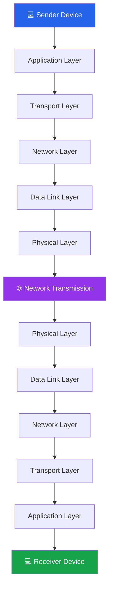
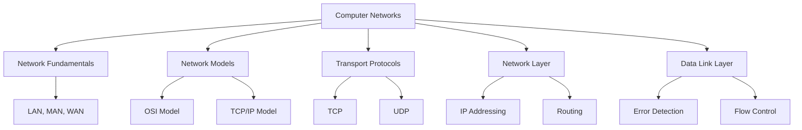

# 🌐 Computer Networks Laboratory

### Exploring the World of Computer Networks Through Practical Implementation

<p align="center">
  
  
  
</p>

<p align="center">
  <b>Understand • Implement • Experiment • Connect</b>
</p>

---

## 📖 About This Repository

Welcome to the **Computer Networks Laboratory (CN Lab)** repository!

This repository contains practical implementations, programs, experiments, and learning resources related to Computer Networks.

The primary objective is to understand how computers communicate, how data travels across networks, and how different networking protocols and technologies work through practical implementation.

From fundamental networking concepts to communication protocols, this repository serves as a practical learning collection for Computer Science and Engineering students.

## 🎯 Objectives

- Understand the fundamentals of computer networking.
- Explore network architectures and communication models.
- Learn how data travels between interconnected devices.
- Understand networking protocols and their applications.
- Develop practical knowledge through programming and experimentation.
- Connect theoretical networking concepts with real-world applications.

---

## 🧠 Computer Networks at a Glance

Computer Networks enable devices to communicate and exchange information through interconnected systems.

### Network Communication Architecture



### The Five Layers of the Internet Protocol Stack

| Layer | Responsibility | Examples |
|---|---|---|
| Application | User-facing network services | HTTP, DNS, SMTP |
| Transport | End-to-end communication | TCP, UDP |
| Network | Logical addressing and routing | IP, ICMP |
| Data Link | Frame delivery and MAC addressing | Ethernet, Wi-Fi |
| Physical | Transmission of raw bits | Cables, radio signals |

---

## 📂 Repository Contents

This repository is organized to maintain practical programs, experiment documentation, and supporting resources.

| Component | Description |
|---|---|
| Practical Programs | Implementations of networking concepts |
| Experiments | Laboratory exercises and assignments |
| Documentation | Explanations and practical observations |
| Outputs | Execution results and screenshots |

> Refer to the repository folders for the available experiments and implementations.

---

## 🔬 Practical Learning Roadmap

The following roadmap represents the major areas of Computer Networks covered in the laboratory curriculum.



---

## ⚙️ Technologies & Tools

The following are commonly used tools for Computer Networks laboratory work. Actual tools depend on the individual experiment.

- **Programming:** C / Python (where applicable)
- **Networking:** TCP/IP, UDP, Socket Programming
- **Simulation:** Cisco Packet Tracer (where applicable)
- **Analysis:** Wireshark (where applicable)
- **Development:** VS Code, Terminal
- **Version Control:** Git & GitHub

---

## 🚀 Getting Started

Clone this repository to your local machine.

```bash
git clone https://github.com/Honeykalastar/CN_Lab.git
```

Navigate into the project directory:

```bash
cd CN_Lab
```

Explore the available practicals and open the required source files using your preferred code editor.

### Prerequisites

Install the compiler, interpreter, or networking software required by the particular experiment.

---

## 🌍 Real-World Applications

Computer Networks are the foundation of modern digital communication.

| Concept | Real-World Application |
|---|---|
| TCP/IP | Reliable internet communication |
| DNS | Converting domain names into IP addresses |
| Routing | Finding paths between networks |
| Error Detection | Detecting corrupted data |
| Flow Control | Managing data transmission rates |
| Socket Programming | Client-server applications |
| Wireless Networking | Wi-Fi communication |

---

## 📚 Learning Outcomes

After completing the laboratory exercises, students should be able to:

- Explain fundamental networking concepts.
- Understand the OSI and TCP/IP models.
- Identify the functions of different networking layers.
- Understand communication protocols.
- Implement and analyze networking programs.
- Understand routing, addressing, and data transmission.
- Relate theoretical concepts to practical networking scenarios.

---

## 🎓 Academic Information

| Field | Details |
|---|---|
| Subject | Computer Networks Laboratory |
| Abbreviation | CN Lab |
| Domain | Computer Science & Engineering |
| Repository Owner | Honey Kalekar |
| GitHub | [@Honeykalastar](https://github.com/Honeykalastar) |

---

## 🤝 Contributions

This repository is maintained for academic learning and practical exploration.

Suggestions, improvements, and contributions that enhance code quality, documentation, and understanding are welcome.

---

## ⭐ Support

If this repository helps you understand Computer Networks, consider giving it a ⭐ on GitHub.

<p align="center">
  <b>Built with curiosity, code, and a passion for networking. 🌐</b>
  <br/>
  <i>Connecting concepts, one packet at a time.</i>
</p>
